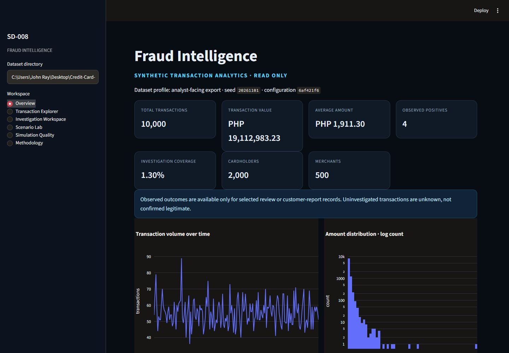
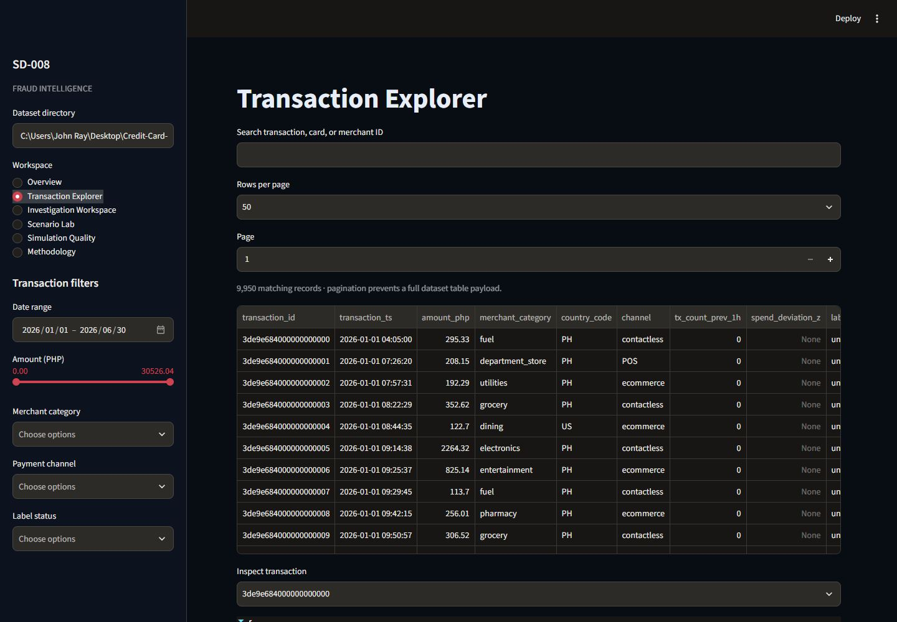
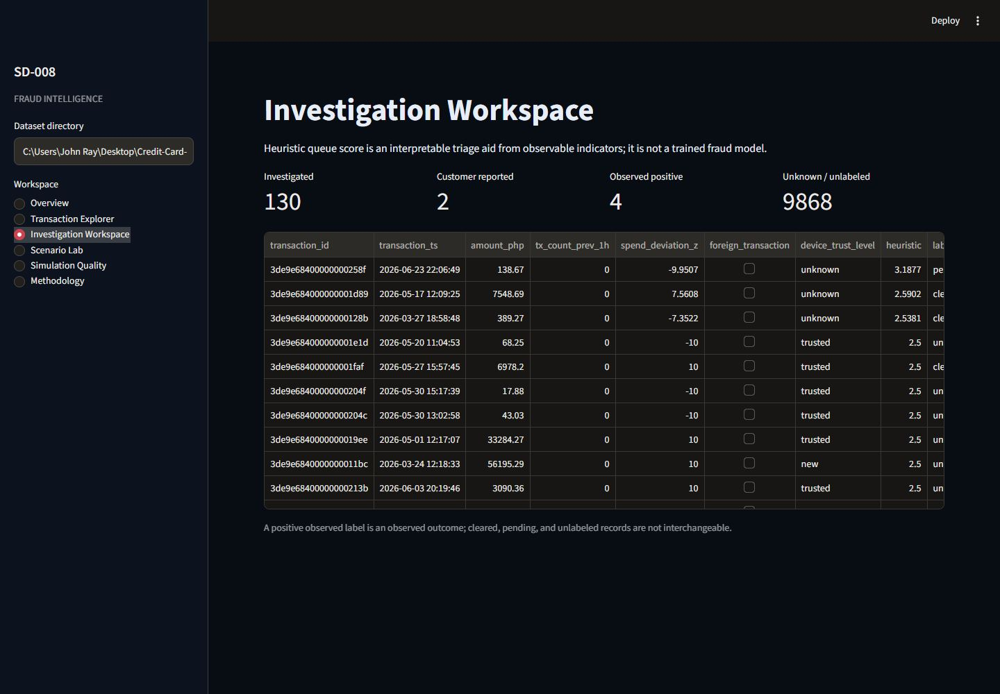
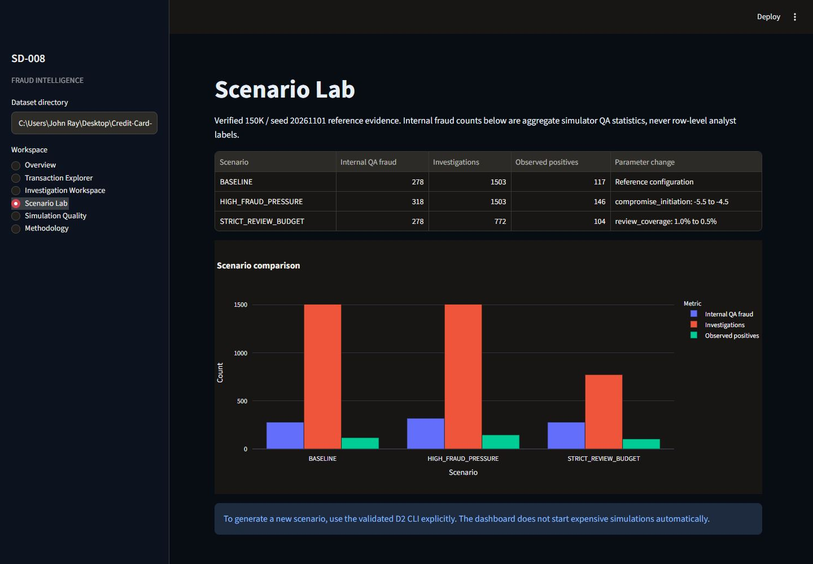
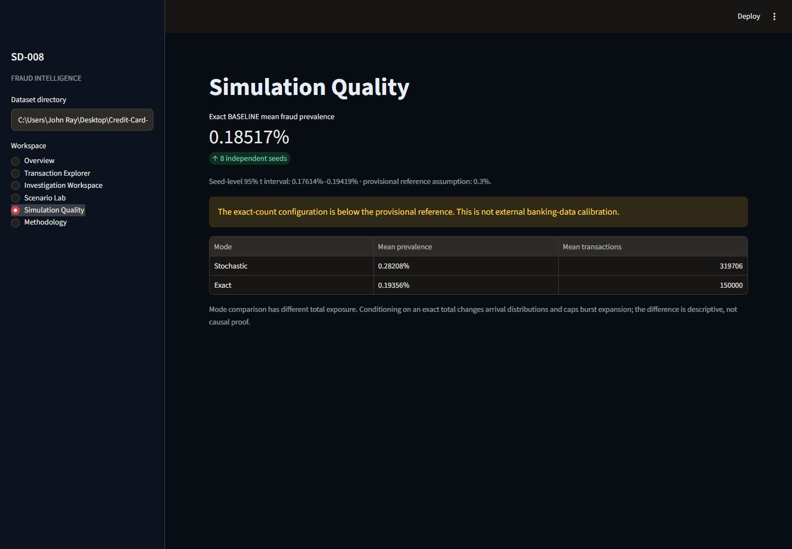
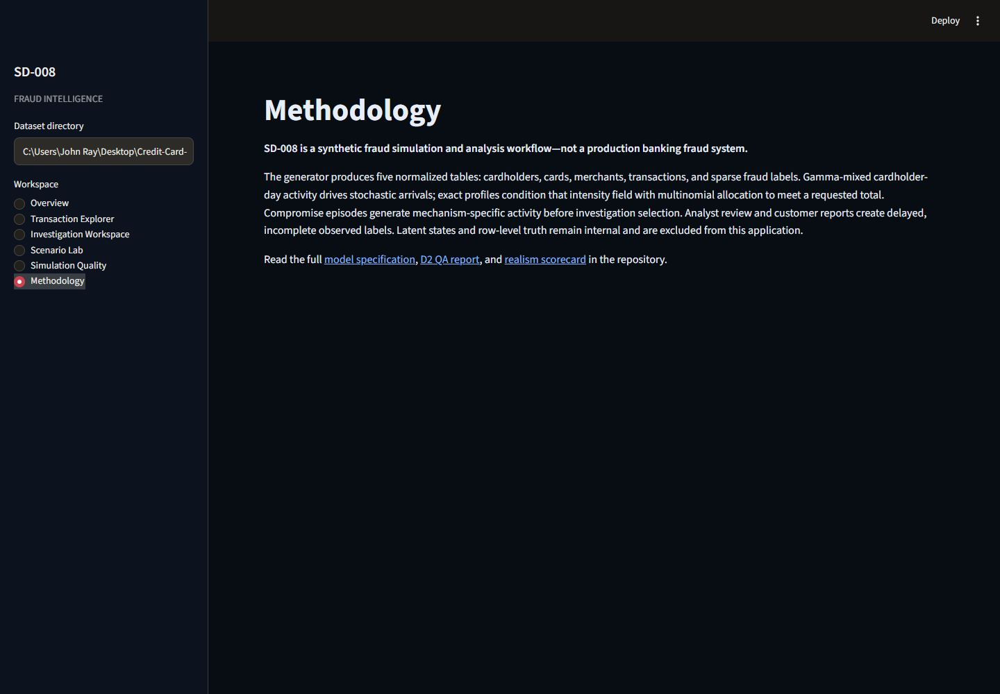
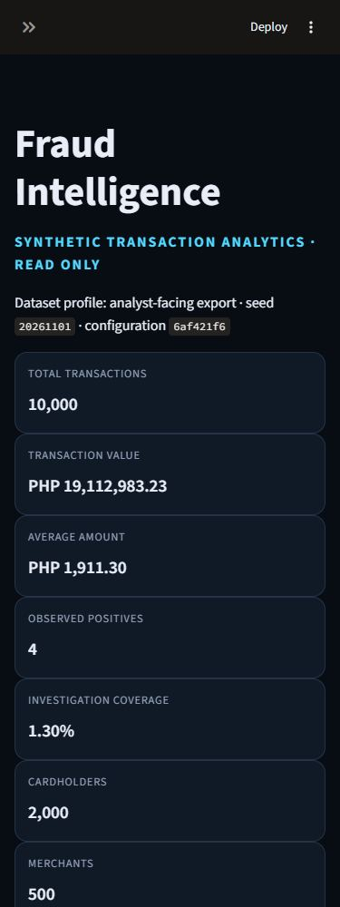

# SD-008 — Synthetic Credit-Card Fraud Detection

SD-008 is an Eskwelabs Data Innovation Track submission that specifies, generates, validates, and analyzes a **fully synthetic** Philippine-context credit-card transaction dataset. It is an educational fraud-analysis environment: it is not a production fraud system, does not contain customer or bank data, and does not claim external banking-data calibration.

The project is designed for an analyst who needs to explore transaction behavior, operational review queues, fraud mechanisms, and the consequences of incomplete labels without exposing real cardholder records.

## What problem does it address?

Fraud data is scarce, sensitive, imbalanced, and often selectively labeled. SD-008 provides a reproducible synthetic alternative that separates three concepts:

- **Internal fraud truth** used only inside generation and aggregate QA.
- **Investigation selection**, a constrained simulated review process.
- **Observed fraud labels**, delayed and incomplete outcomes available to an analyst.

Uninvestigated transactions are therefore unknown—not confirmed legitimate. Latent simulator states and row-level ground truth are deliberately excluded from analyst-facing exports and from the dashboard.

## Deliverables

| Deliverable | Purpose | Canonical artifact |
| --- | --- | --- |
| D1 — Model Research and Specifications | Research basis, ERD, distributions, equations, calibration plan, and data dictionary | [Word document](deliverables/D1_Model_Research_and_Specifications/SD-008_Model_Research_and_Specifications.docx) · [accessible specification](docs/modeling/SD-008_MODEL_SPECIFICATION.md) |
| D2 — Synthetic Dataset Generator | Seeded five-table generator, configuration, validation, and exports | [notebook](deliverables/D2_Synthetic_Dataset_Generator/D2_Synthetic_Dataset_Generator.ipynb) · [implementation guide](deliverables/D2_Synthetic_Dataset_Generator/README.md) |
| D3 — Exploratory Data Analysis | Reproducible analyst-facing EDA with incomplete-label interpretation | [notebook](deliverables/D3_Exploratory_Data_Analysis/02_Fraud_Analytics_EDA.ipynb) · [analysis guide](deliverables/D3_Exploratory_Data_Analysis/README.md) |
| Optional — Fraud Intelligence Dashboard | Read-only Streamlit workspace for local analyst-facing exports | [dashboard](dashboard/README.md) |

For an instructor-facing path list and reproduction checklist, see [Final submission manifest](docs/FINAL_SUBMISSION.md).

## System architecture

```text
D1 specification + approved scenario YAML
                  │
                  ▼
D2 generator ──► five analyst-facing CSV tables + manifest + aggregate label-gap summary
                  │                                      │
                  │                                      ├──► D3 executed EDA notebook
                  │                                      └──► read-only Streamlit dashboard
                  ▼
          internal simulator diagnostics (QA only; never row-level analyst data)
```

The normalized analytical schema has five tables: `cardholders`, `cards`, `merchants`, `transactions`, and `fraud_labels`. `label_gap_summary.csv` is a separate aggregate-only QA artifact. It can contain grouped ground-truth counts, but contains no transaction IDs, timestamps, or row-level values.

## Generation and labeling methodology

The simulator creates cardholder, card, merchant, and time-varying behavioral states before observable transactions. It models account takeover, card-not-present compromise, merchant compromise, burst activity, geography, velocity, and amount behavior. Strictly prior rolling features prevent future leakage.

Two count modes are documented:

- **Stochastic mode** uses the Gamma–Poisson arrival process.
- **Exact-count profiles** condition the sampled intensity field and allocate events multinomially to produce exactly 10K (`SMALL`), 150K (`BASELINE`), or 1M (`STRESS`) transactions.

Exact-count conditioning preserves the requested total but changes unconditional arrival behavior and constrains burst expansion; it is not distributionally identical to stochastic mode.

Fraud states are generated before review. The review process is intentionally selective, while customer reports and review outcomes create delayed, incomplete observed labels. The dashboard exposes observable indicators and label status only—not trained risk scores, latent states, or row-level truth.

## Measured evidence and validation

All measurements below are persisted in the QA reports; they are simulation diagnostics, not real-world banking validation.

| Evidence | Verified result |
| --- | --- |
| Exact generation | 10K, 150K, and 1M transaction profiles completed with export validation |
| 1M benchmark | About 96 seconds; observed peak process working set about 1.22 GiB |
| Exact BASELINE calibration | Eight seeds: mean internal prevalence **0.18517%**; 95% t interval 0.17614%–0.19419% |
| Provisional reference | 0.3%; exact mode is below this reference by 0.11483 percentage points |
| Scenario evidence | High fraud pressure: 278 → 318 internal QA fraud; strict review budget: 1,503 → 772 investigations |
| D3 evidence | Executed on a fresh exact 150K BASELINE export using analyst-facing tables only |
| Current CI | Python 3.12.16, six D1 checks, **102 tests passed**, fresh D2 generation, and executed D3 notebook |

Read the [D2 data quality report](docs/qa/D2_DATA_QUALITY_REPORT.md), [synthetic realism scorecard](docs/qa/SYNTHETIC_REALISM_SCORECARD.md), and [end-to-end validation report](docs/qa/END_TO_END_VALIDATION_REPORT.md) for methods, evidence boundaries, and limitations.

## Dashboard showcase

These are actual captures of the local Streamlit application at a 1440px desktop viewport, using the repository's 10K synthetic smoke export. The Scenario Lab and Simulation Quality views display persisted aggregate QA evidence, clearly separated from analyst-facing records.

| Overview | Transaction Explorer |
| --- | --- |
|  |  |
| Investigation Workspace | Scenario Lab |
|  |  |
| Simulation Quality | Methodology |
|  |  |

<p align="center"></p>

The explorer paginates records; its filters, transaction inspection, and investigation queue use analyst-facing fields only. The dashboard does not run simulations automatically.

## Reproduce from a clean clone

**Validated reference:** Python 3.12. The current GitHub Actions smoke run uses CPython 3.12.16.

```bash
git clone https://github.com/sinagdevv/Credit-Card-Fraud-Detection.git
cd Credit-Card-Fraud-Detection
python -m venv .venv
```

Activate the environment with `.venv\Scripts\Activate.ps1` on PowerShell or `source .venv/bin/activate` on macOS/Linux, then install and test:

```bash
python -m pip install --upgrade pip
python -m pip install -r requirements.txt
python tools/validate_d1.py
python -m pytest tests -q
```

Generate an exact 150K BASELINE export:

```bash
cd deliverables/D2_Synthetic_Dataset_Generator
python -m sd008_gen.generate --config config/scenario_v0.yaml --out outputs --profile BASELINE --seed 20261101
cd ../..
```

Run D3 against that output root (the notebook resolves its single `run_*` child):

```powershell
$env:DATA_DIR = "deliverables/D2_Synthetic_Dataset_Generator/outputs"
jupyter nbconvert --to notebook --execute --inplace deliverables/D3_Exploratory_Data_Analysis/02_Fraud_Analytics_EDA.ipynb --ExecutePreprocessor.timeout=180
```

On macOS/Linux, set `DATA_DIR=deliverables/D2_Synthetic_Dataset_Generator/outputs` before the same `jupyter nbconvert` command. To run the dashboard:

```powershell
$env:SD008_DATA_DIR = "deliverables/D2_Synthetic_Dataset_Generator/outputs"
streamlit run dashboard/app.py
```

The 1M STRESS profile is a local performance workload; keep its generated output outside version control. Generated CSV files, models, and local output directories are gitignored.

## Scientific limits

- All records are synthetic; no claim is made about real Philippine credit-card fraud prevalence or production model performance.
- The provisional 0.3% reference is not achieved by exact mode and is not an external calibration target.
- Exact-count conditioning changes the unconditional arrival distribution and caps burst expansion.
- Scenario comparisons are matched single-seed demonstrations, not uncertainty-qualified causal estimates.
- Open vocabularies and the unpinned dependency file are documented implementation limitations.

## Academic attribution

This project was prepared for the Eskwelabs Innovation Fellowship Data Innovation Track. The model specification distinguishes source-supported context, registered assumptions, and open proposals. Please retain those distinctions—and the limitations above—when reusing or presenting the work.
