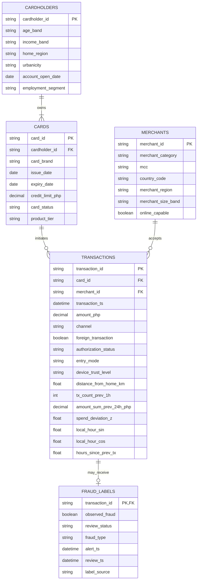

# SD-008 Model Research and Specifications

**Deliverable 1 technical draft**  
**Program:** Eskwelabs Innovation Fellowship Data Innovation Track  
**Domain:** Philippine credit-card transaction fraud analytics  
**Prepared for:** Fraud analysts and the SD-008 implementation team  
**Status:** Submission candidate; technical QA complete, team review pending

## Executive summary

This specification defines an implementation-ready hybrid simulator for Philippine credit-card transactions without using customer records. It separates five concepts that are often conflated: normal customer behavior, latent compromise, true fraud generated by the simulator, alert selection, and the sparse labels observed after analyst review. The exported design contains five normalized tables and 38 analytical features excluding keys. Internal ground truth and latent risk factors are prohibited from analyst-facing exports.

The simulator combines entity-level distributions, a chronological transaction process, conditional amount and merchant selection, persistent compromise states, a calibrated fraud model, and a capacity-constrained observation process. A provisional 0.3% underlying fraud rate and 1% review coverage are scenario targets, not Philippine industry estimates. The logistic intercept is solved numerically for each configuration so the requested base rate remains explicit and testable.

The principal conclusion is that realistic synthetic fraud data cannot be produced by randomly flipping labels. Fraud episodes must be sampled before their affected transaction attributes and must alter amount, channel, merchant choice, device, geography, or velocity through explicit structural relationships. Observed labels are generated later and separately because analysts review only a selected subset and customer-confirmed outcomes may arrive after the transaction.

## Status vocabulary

- **SUPPORTED** - directly grounded in a cited source.
- **CALIBRATED** - determined by an explicit fitting or root-finding procedure against a declared target.
- **ASSUMED** - a provisional scenario choice, not an empirical fact.
- **OPEN** - requires Jee's verification or additional Philippine card-specific evidence.

# 1 Introduction and problem framing

## 1.1 Project overview

SD-008 will generate relational, privacy-preserving synthetic credit-card data for fraud-detection education and experimentation. Deliverable 1 specifies the data-generating process; it does not implement the generator, train a classifier, or claim production validity. The target end user is a fraud analyst who needs temporally valid behavioral features, review outcomes, and enough ambiguity to test triage methods realistically.

## 1.2 Problem statement

Real card data are scarce because transaction histories expose financial behavior and operational controls. Public benchmarks are useful but often short, anonymized, geographically mismatched, or fully labeled. SD-008 therefore needs a transparent simulator whose parameters, dependencies, sampling order, omissions, and limitations are auditable.

Fraud detection is difficult because fraud is rare, behavior changes, legitimate and fraudulent transactions overlap, and reliable labels arrive selectively and late. Dal Pozzolo et al. (2015, 2018) show that class imbalance, concept drift, investigator feedback, and delayed customer reports must be handled explicitly; Le Borgne et al. (2022) document the same issues in a reproducible practitioner handbook. A dataset with perfect immediate labels would remove an important operational difficulty.

## 1.3 Philippine digital banking context

The BSP reported that digital payments represented 57.4% of retail-payment volume and 59.0% of value in measurement year 2024 (Bangko Sentral ng Pilipinas [BSP], 2025). Its 2025 report records a further increase to 64.7% by volume (BSP, 2026). These adoption measures cover retail-payment instruments including transfers, QR payments, e-money, and cards; they are **not** credit-card shares and **not** fraud rates. BSP Circular No. 1019 distinguishes card-present counterfeit exposure from card-not-present and contactless transactions (BSP, 2018). Circular No. 1195 governs account-to-account electronic fund transfers under the NRPS and is therefore not used as a general credit-card dispute rule (BSP, 2024).

Philippine fraud evidence is likewise definition-sensitive. TransUnion reported a 4.1% suspected digital-fraud indicator rate for 2025 across client websites and applications, with 6.1% at login, 4.5% at account creation, and 1.1% at financial transactions (TransUnion, 2026). Those indicators include policy violations and multiple industries; they are not confirmed issuer credit-card fraud probabilities. A BSP briefing reported by Ta-Asan (2026) attributed 76% of reported cyber-fraud losses to social engineering, account takeover, and identity theft collectively and 8% to card-not-present fraud. These are shares of reported losses, not transaction frequencies or fraud-type generation probabilities. A 2026 survey found that 84% of 1,160 Filipino adults encountered a scam attempt and only 4% reported one to authorities (Philippine News Agency, 2026); the survey describes exposure and under-reporting, not card incidence. Together, the sources support modeling credential compromise, selective reporting, and delayed observation while leaving prevalence parameters open.

## 1.4 Target end user fraud analyst

The analyst receives only evidence available at or after the relevant operational time: entity attributes, the current authorization request, historical aggregates computed from earlier events, alert metadata, and any completed investigation. The analyst decides which alerts to prioritize, which cases need escalation, and how thresholds trade missed fraud against false alerts. False positives consume limited review capacity and inconvenience customers; false negatives leave unauthorized activity undetected. Unusual behavior is evidence, not proof: travel, large purchases, new devices, and rapid legitimate spending overlap fraud. Conversely, attackers may deliberately imitate ordinary spending. The analyst never receives the simulator's true fraud state, compromise state, latent propensities, future transactions, or future review outcomes.

## 1.5 Business and analytical use cases

1. Compare fraud models under extreme class imbalance.
2. Test alert queues under fixed review capacity.
3. Evaluate card-not-present, account-takeover, amount, velocity, merchant, and geographic signals.
4. Demonstrate time-safe feature engineering and chronological validation.
5. Study selective labeling and delayed confirmation.
6. Stress-test parameter sensitivity without exposing customers.

## 1.6 Scope and exclusions

In scope are consumer credit-card purchase attempts, Philippine-issued synthetic cards, domestic and foreign merchants, authorization outcomes, latent third-party fraud, alerts, reviews, and observed labels. Excluded are debit and prepaid rails, cash advances, chargeback accounting, issuer losses, identity onboarding, money laundering, first-party fraud, network message fields, production decisioning, real personally identifiable information, and Deliverables 2 and 3.

## 1.7 Meaning of realistic synthetic data

Realism means preserving declared statistical and operational properties: valid relationships, plausible marginal distributions, customer heterogeneity, temporal clustering, conditional dependence, rare fraud, overlapping classes, incomplete labels, and reproducibility. It does not mean reproducing a real bank or making every row look noisy. CardSim likewise motivates payer/payee profiles, daily event simulation, skewed payment values, and adjustable fraud mechanisms (Allen, 2025).

## 1.8 Research methodology

Desk research prioritized BSP publications and primary peer-reviewed or institutional research. Evidence was used to select mechanisms, not to import foreign numerical values as Philippine facts. Each parameter is classified; unsupported numbers remain assumptions or open items. The draft uses a reproducible model contract so Jee can verify sources and replace assumptions without changing the dependency structure.

# 2 Literature review and variable identification

## 2.1 Fraud mechanisms represented

- **Card-not-present fraud:** compromised credentials raise the probability of online transactions, unfamiliar devices, foreign merchants, and amount or velocity deviations.
- **Account takeover:** a persistent compromise episode changes channel, device trust, location, merchant mix, and transaction intensity rather than only the label.
- **Unusual amount:** transaction value is compared with the cardholder's prior history; overlap is retained because legitimate large purchases occur.
- **Velocity spike:** bursts create multiple attempts in short windows; all rolling features are computed strictly before the current event.
- **Merchant and geographic anomaly:** merchant vulnerability and distance/foreign status influence risk, while legitimate travel remains possible.
- **Incomplete labeling:** only reviewed or later reported transactions obtain a fraud-label row; missing means unknown, not legitimate.

## 2.2 Research evidence matrix

| Research claim | Supporting source | Year | Variable or relationship | Modeling implication | Strength | Limitation |
|---|---|---:|---|---|---|---|
| Philippine retail payments are increasingly digital | BSP 2024 and 2025 E-Payments Measurement Reports | 2025-2026 | channel mix context | include online and digital channels | Strong | ecosystem statistic, not card-specific |
| EMV rules distinguish card-present counterfeit exposure from CNP/contactless | BSP Circular 1019 | 2018 | `channel`, `entry_mode` | model channel-specific fraud mechanisms | Strong | regulatory scope is not prevalence evidence |
| Fraud streams are imbalanced and non-stationary | Dal Pozzolo et al. | 2014 | fraud rate, time | preserve rarity and drift scenarios | Strong | proprietary European data |
| Investigator feedback and delayed labels differ operationally | Dal Pozzolo et al. | 2015 | review and label timestamps | separate review from later reporting | Strong | exact delays are not transferable |
| Realistic fraud evaluation must model verification latency | Dal Pozzolo et al. | 2018 | sparse observed labels | no missing-row-equals-legitimate shortcut | Strong | foreign issuer environment |
| Payment amounts are heavily right-skewed and lognormal is usable | Allen | 2025 | `amount_php` | conditional lognormal with caps | Moderate | US diary calibration, mixed debit/credit context |
| Daily transaction counts can be simulated with a count process | Allen | 2025 | arrivals | Poisson baseline with gamma heterogeneity | Moderate | Philippine rate requires calibration |
| Entity profiles plus event simulation support scalable synthetic card data | Allen | 2025 | full architecture | use payer, merchant, and event phases | Strong | Bayesian fraud formulation differs here |
| Public ULB data demonstrate extreme imbalance | Dal Pozzolo et al. / ULB benchmark | 2015-2018 | validation scenario | use only as sensitivity reference | Moderate | two days and anonymized features |
| Online features must be computed from past events | Carcillo et al. | 2018 | velocity and deviation | sort chronologically and update after scoring | Strong | implementation details need D2 validation |
| Synthetic simulation protects sensitive payment records but needs validation | Allen | 2025 | project rationale | publish assumptions and validation targets | Strong | synthetic data do not prove external validity |
| Consumer protection requires fraud controls and transaction notification | BSP Circular 1169 FAQ | 2023 | review/report process | allow customer-report label source | Strong | policy principle, not distribution evidence |
| Philippine suspected digital-fraud indicators concentrate at login more than transactions | TransUnion Philippines analysis | 2026; measures 2025 | account takeover and device context | retain credential-compromise mechanism | Moderate | proprietary indicators include policy violations and non-card industries |
| Social engineering, ATO, and identity theft dominate reported loss shares in a BSP briefing | Ta-Asan reporting BSP briefing | 2026; measures 2025 | fraud context | model compromise but do not set type probabilities | Moderate | secondary report; loss shares, not event shares |
| Scam exposure is widespread but formal reporting is sparse | Philippine News Agency reporting GASA survey | 2026 | observation process | allow large true-observed gap | Moderate | self-reported survey, not card incidence |
| Original imbalance and precision-recall measures matter for operational evaluation | Baisholan et al. | 2025 | validation metrics | preserve natural test prevalence; report AUC-PR | Strong | systematic review depends on published benchmark studies |
| Leakage can inflate reported fraud performance | Hayat and Magnier | 2025 | feature and split design | chronological splits; fit preprocessing on training history | Strong | methodological review, not generator calibration |
| Balanced or resampled test sets can be optimistic under rare events | Ma et al. | 2026 | evaluation design | evaluate on untouched temporal prevalence | Moderate | one benchmark study; no Philippine calibration |
| Behavioral profiling and adaptation are foundational statistical fraud concepts | Bolton and Hand | 2002 | individual baselines and drift | generate heterogeneous profiles and changing states | Strong | broad fraud review predates current payment channels |

## 2.3 Evidence gaps

Philippine credit-card-specific amount distributions, channel proportions, fraud prevalence, fraud-type mix, review capacity, label delay, and merchant concentration were not verified. They remain **OPEN**. The 4.1% TransUnion suspected-digital-fraud rate, the BSP-reported loss composition, the 84% scam-exposure survey result, and BSP retail-payment adoption rates are contextual evidence only and are not generator prevalence parameters.

# 3 System definition and data architecture

## 3.1 Normalized tables and relationships

The analyst-facing dataset has five tables. Cardinalities are: one cardholder to one-or-more cards; one card to zero-or-more transactions; one merchant to zero-or-more transactions; and one transaction to zero-or-one observed fraud label. A card must have exactly one cardholder and a transaction exactly one card and merchant. `fraud_labels` is sparse.

## 3.2 Entity relationship diagram source

The rendered image is stored at `deliverables/D1_Model_Research_and_Specifications/assets/SD-008_ERD.png` and embedded in the Word version.

## 3.3 Constraints and label reconstruction

IDs are synthetic opaque strings. Dates obey `account_open_date <= issue_date <= transaction_ts < expiry_date`. Amounts are positive for approved and declined purchase attempts; `authorization_status` is from a closed vocabulary. Merchant region is country-consistent: domestic merchants use a Philippine region and foreign merchants a foreign area that belongs to their country. A `fraud_labels` row exists only after alert review or customer-report sampling. If `review_status` is `confirmed` or `cleared`, `observed_fraud` is non-null (true and false respectively); pending reviews have null outcomes.

For model training, construct `training_label` only from rows with resolved review outcomes or matured customer reports. Unlabeled transactions remain null and are excluded from ordinary supervised loss, used in positive-unlabeled methods, or sampled under an explicitly documented negative-maturation rule. They must never be automatically set to zero.

# 4 Statistical model and distributions

## 4.1 Modeling strategy

The hybrid model uses hierarchical entity distributions and a chronological event simulator. Gamma-Poisson mixing yields heterogeneous and overdispersed counts; lognormal amounts provide positive right skew; categorical logits model context-dependent choices; beta variables represent bounded propensities; two-state Markov processes create compromise episodes; and logistic Bernoulli draws connect risk factors to fraud and review outcomes.

## 4.2 Variable family summary

| Variable group | Distribution | Parents | Constraints | Evidence | Validation |
|---|---|---|---|---|---|
| age band | categorical from truncated age profile | region | adult bands only | ASSUMED/OPEN | band shares |
| income band | ordered categorical logit | age, region, employment | fixed vocabulary | ASSUMED/OPEN | cross-tab plausibility |
| account age | truncated gamma | age band | 30 days to 20 years | ASSUMED | quantiles, date checks |
| card count | 1 + truncated Poisson | income, account age | 1-4 | ASSUMED | cards per holder |
| credit limit | truncated lognormal | income, tier, account age | PHP 5k-2m | ASSUMED/OPEN | conditional quantiles |
| merchant category | categorical | global weights | valid MCC mapping | SUPPORTED structure | category shares |
| daily arrivals | negative-binomial equivalent | spending propensity, weekday | nonnegative | SUPPORTED family | mean/variance, zero days |
| amount | capped lognormal mixture | person, category, channel, fraud state | PHP 1-500k scenario cap | SUPPORTED family | p50/p95/p99, tail |
| merchant selection | categorical softmax | preferences, distance, online | active merchants | ASSUMED | concentration, repeat rate |
| foreign flag | Bernoulli logit | travel propensity, channel, compromise | binary | ASSUMED | rate by profile |
| compromise state | Markov Bernoulli transition | exposure, merchant vulnerability | causal time order | ASSUMED | episode duration |
| fraud truth | Bernoulli logit | state and current/past context | binary internal only | CALIBRATED | rate and concentration |
| review selection | capacity-constrained weighted sample | alert score | target coverage | ASSUMED/CALIBRATED | coverage and bias |
| observed label | Bernoulli misclassification/delay | true fraud, source | sparse export | SUPPORTED mechanism | latent-observed gap |

# 5 Explicit mathematical model

## 5.1 Notation and sampling order

Indices are cardholders (i), cards (c), merchants (m), days (d), and chronologically ordered transaction opportunities (k). `logit^-1(x)=1/(1+exp(-x))`. Gamma(k, theta) uses shape k and scale theta. All parameters belong to a versioned registry. The causal order is: configuration and seed; entity latents and profiles; merchant latents and profiles; card profiles; daily travel and compromise-state transitions; transaction opportunities and timestamps; fraud-mechanism activation; transaction channel, merchant, device, geography, and amount conditional on the active state; strictly pre-event historical features; internal outcome `Y_true`; authorization and alert scoring; investigation indicator `R`; delayed observed outcome `Y_observed`; allowlisted export. This order prevents a post-hoc label flip from masquerading as a fraud mechanism.

## 5.2 Cardholder attributes

1. **Demographic stratum:** (R_i \sim Categorical(\pi_R)), (A_i \sim Categorical(\pi_{A|R_i})), and (E_i \sim Categorical(\pi_{E|A_i})). Age is exported only as a band to reduce pseudo-identification.
2. **Income:** (P(I_i=j)=softmax_j(\alpha_j + u_{j,A_i}+v_{j,R_i}+w_{j,E_i})).
3. **Account tenure:** (T_i=min(7300,max(30,Gamma(k_T,\theta_{T,I_i})))) days; open date is simulation start minus (T_i).

## 5.3 Latent spending and exposure

4. **Spending propensity:** (S_i \sim Beta(a_S,b_S)). It affects arrival intensity, typical amount, and premium-tier probability.
5. **ATO exposure:** (U_i \sim Beta(a_U,b_U)). It affects compromise initiation and unfamiliar-device probability.
6. **Travel propensity:** (G_i \sim Beta(a_G,b_G)). It affects legitimate foreign and distance behavior, preventing foreign transactions from becoming deterministic fraud signals.

## 5.4 Card issuance and credit limits

7. **Card count:** (N_i=1+min(3,Poisson(exp(\eta_0+\eta_I[I_i]+\eta_T log(1+T_i))))).
8. **Limit:** (L_c=clip(exp(\mu_L+\lambda_I[I_i]+\lambda_Q[Q_c]+\lambda_T log(1+T_i)+\epsilon_c),5000,2000000)), (epsilon_c\sim N(0,\sigma_L^2)). The bounds are **ASSUMED** and must be reviewed.

Card validity: every card is valid on the simulation start date, with `issue_date` drawn within the 3 years before the start and after `account_open_date`, and `expiry_date` equal to issue plus 3-5 years and after the start. Cards that expire during the window are not used after expiry; there is no reissue in v0.

## 5.5 Merchant characteristics and preferences

9. **Merchant:** category (C_m\sim Categorical(\pi_C)), country (K_m\sim Categorical(\pi_K)), size (Z_m\sim Categorical(\pi_{Z|C_m})), and vulnerability (V_m\sim Beta(a_V[C_m],b_V[C_m])). Each cardholder preference vector is (P_i\sim Dirichlet(\kappa\pi_C)).

## 5.6 Transaction arrivals and timestamps

10. **Daily intensity:** (\Lambda_{id}=\lambda_0 exp(\rho_S logit(S_i)+\rho_w[weekday_d]+\rho_h[holiday_d]+b_i)), with (b_i\sim N(0,\sigma_b^2)). Counts follow (N_{id}\sim NegBin(mean=\Lambda_{id},dispersion=r_N)), equivalently a gamma-Poisson mixture. Times within day are drawn from a categorical hourly profile plus uniform minutes/seconds. Duplicates are allowed only if timestamps differ at the configured resolution.

## 5.7 Merchant channel and foreign selection

11. **Category, channel and merchant, in that order:** The merchant category (C_m) is drawn first from the customer's category preferences (P_{i,C_m}) and active state; the channel (H_k) is then drawn conditional on (C_m); a specific merchant is drawn last. Let (Z_{c,d}=(B_{i,d},C_{c,d})) denote active compromise states. (P(H_k=h given Z_{c,d})=softmax_h(\delta_h+\delta_{h,C_m}+\delta_{h,tod}+\delta_{h,S_i}+\delta_{h,Z}Z_{c,d})). Merchant selection within the drawn category is proportional to (popularity_m\,exp(-\tau D_{im})) for physical channels, with online-capability and vulnerability weights entering only when the channel and state permit them. The distance (D_{im}) is derived from regions because merchants have no coordinates: a merchant in the holder's `home_region` is near, one in another Philippine region is far, and a foreign merchant is very far, with a per-pair distance drawn from tier-specific gamma parameters; merchant location stays internal and no column is exported for it. Thus a compromise can change the transaction before the fraud outcome is drawn.
12. **Foreign and geography:** The merchant pool is drawn first: (P(pool_k=foreign)=logit^{-1}(\phi_0+\phi_G logit(G_i)+\phi_H[H_k]+\phi_X X_{i,d}+\phi_Z Z_{c,d}))), where (X_{i,d}) is a temporary legitimate travel state. The merchant is then sampled from the drawn pool, and `country_code`, `merchant_region` and (F_k=1[country_m\ne PH]) are all derived from that merchant, so they cannot contradict each other. Legitimate travel and compromise can both produce geographic anomalies.

## 5.8 Legitimate amount generation

13. **Amount conditional on mechanism:** A baseline draw satisfies (log A_k^{base}\sim N(\mu_i+\mu_C[C_m]+\mu_H[H_k]+\mu_t[tod_k],\sigma_i^2+\sigma_C^2[C_m])). The realized log amount is (log A_k=log A_k^{base}+\Delta_T[T_k]+e_{T,k}), where (T_k=0) for no active fraud mechanism and (\Delta_T[0]=e_{0,k}=0); for fraud mechanisms (e_{T,k}\sim N(0,sd_T)) with a per-type SD. The value is (A_k=clip(round(exp(log A_k),2),1,500000)). This preserves overlap because fraud shifts a distribution rather than deterministically fixing an amount.

14a. **Supporting attributes:** `device_trust_level` is drawn from (\pi(device\mid H_k,Z_{c,d},T_k)) with categories trusted/new/unknown; `distance_from_home_km` is Gamma-distributed with a mean that increases with (X_{i,d}) and foreign status and is null for online channels; `product_tier` is categorical logit in income and spend propensity; the card used for an event is drawn among the holder's active (non-expired) cards with weights proportional to a per-card usage share drawn from a Dirichlet at card creation. `entry_mode` follows a fixed lookup on channel: POS gives chip, contactless gives contactless, mail-phone gives manual, and ecommerce gives tokenized with probability (p_{token}) and manual otherwise. These draws precede the behavioral features of Section 5.9.

## 5.9 Time-safe behavioral features

Before sampling fraud for event (k), use only transactions (j<k):

14. (tx_count_prev_1h_k=\sum_{j<k}1[t_k-1h < t_j]); (amount_sum_prev_24h_php_k=\sum_{j<k}A_j1[approved_j=1]1[t_k-24h<t_j]); (spend_deviation_z_k=(log A_k-\hat\mu_{i,k^-})/max(\hat\sigma_{i,k^-},\sigma_{floor})); and (hours_since_prev_tx_k=(t_k-t_{k-1})/1h). Here (\hat\mu_{i,k^-}) and (\hat\sigma_{i,k^-}) are the running mean and SD of the prior log amounts of that card, and (spend_deviation_z_k) is null when the card has fewer than 3 prior transactions. `tx_count_prev_1h` counts all prior attempts, while `amount_sum_prev_24h_php` sums approved amounts only. These are the exact exported field names. The rolling state is updated only after the current row is finalized.

## 5.10 Compromise and fraud episodes

15. **Episode states:** (B_{i,d}\in\{0,1\}), with (P(B_{i,d}=1 given B_{i,d-1}=0)=logit^{-1}(\omega_0+\omega_U logit(U_i)+\omega_V \bar V_{i,d-1})), and (P(B_{i,d}=0 given B_{i,d-1}=1)=q_{recover}). CNP credential compromise uses an analogous card-level state (C_{c,d}). Legitimate travel state (X_{i,d}) follows its own two-state Markov process driven by (G_i): the daily start probability is (q_{travel,on} G_i/E[G]), capped at 1, and the end probability is (q_{travel,off}). Here (\bar V_{i,d-1}) is the mean vulnerability (V_m) of the merchants the holder transacted with on day (d-1), and 0 if there were none. When a card-level compromise episode starts, its flavor is merchant_compromise with probability (logit^{-1}(\zeta_0+\zeta_V \bar V_{i,d-1})), increasing in (\bar V_{i,d-1}), and cnp otherwise; the flavor persists for the episode and feeds (\pi_T). All states transition before the day's affected events and persist until their modeled recovery transition.

16. **Fraud propensity:**

(p_k=1[T_k\ne none]\cdot logit^{-1}(\beta_0+\beta_B B_{i,d}+\beta_C C_{c,d}+\beta_V V_m+\beta_F foreign_transaction_k+\beta_H 1[channel_k=CNP]+\beta_z|spend_deviation_z_k|+\beta_v log(1+tx_count_prev_1h_k)+\beta_d 1[device_trust_level_k=unknown]+\beta_{BV}B_{i,d}V_m)).

Fraud requires an active mechanism: the factor (1[T_k\ne none]) sets (p_k=0) when the candidate type is none, so opportunities with (T_k=none) are always legitimate ((Y_{true,k}=0)). Every other term is the same logit coefficient list. The internal outcome is (Y_{true,k}\sim Bernoulli(p_k)). The outcome records whether the state-conditioned opportunity became unauthorized fraud; it does not create the observable pattern after the fact. (\beta_0) is **CALIBRATED**; other coefficients start as **ASSUMED** monotone effects and undergo sensitivity analysis.

17. **Fraud mechanism and burst behavior:** Before affected attributes are finalized, candidate type (T_k\sim Categorical(\pi_T(B,C,H))) is sampled from active states over the closed vocabulary {none, cnp, ato, burst, merchant_compromise}. CNP mechanisms increase, but do not force, ecommerce/manual entry and unfamiliar devices; ATO changes device, merchant, and geography distributions; burst mechanisms draw (1+Poisson(\lambda_{burst})) opportunities with short exponential gaps. If (Y_{true,k}=0), the opportunity remains a legitimate state-conditioned event or is discarded according to the configured mechanism: non-fraud burst opportunities are discarded, and non-fraud opportunities of all other mechanisms are retained as legitimate events. While a card's CNP compromise state is active, the combined cnp and merchant_compromise probability mass of (\pi_T) goes entirely to that episode's flavor, never a mix. No observable feature is a deterministic fraud code.

## 5.11 Authorization alert review and observed labels

18. **Authorization:** (P(approved_k=1)=logit^{-1}(\gamma_0-\gamma_L amount_php_k/credit_limit_php_c-\gamma_v log(1+tx_count_prev_1h_k)-\gamma_r riskScore_k)), where the pre-authorization score is (riskScore_k=\psi_z|spend_deviation_z_k|+\psi_F F_k+\psi_d 1[device_trust_level_k=unknown]), computed only from observable features available at authorization time and separate from the later alert score in Eq 19. Missing (spend_deviation_z_k) contributes 0 and a missing device trust level is treated as unknown. (Y_{true,k}) does not enter authorization or alert scoring directly; it acts only through the observable features it influenced. Declined attempts remain transactions but do not update approved-spend aggregates.

19. **Alert and investigation:** (score_k=\theta_0+\theta_z|spend_deviation_z_k|+\theta_v log(1+tx_count_prev_1h_k)+\theta_F foreign_transaction_k+\theta_d 1[device_trust_level_k=unknown]+\epsilon_k), (\epsilon_k\sim Logistic(0,s)). A null (spend_deviation_z_k) contributes 0 (no history is no evidence) and a null device trust level is treated as unknown. A daily capacity-constrained selection produces (R_k\in\{0,1\}), where R=1 means investigated: each day the highest-scoring transactions are investigated up to (capacity_d=round(r_r \times) the number of that day's transactions). Because (R) depends on observable risk, reviewed transactions are not a random sample.

20. **Observed label:** Define (Y_{observed,k}) only when (R_k=1) or a delayed customer/reporting pathway matures. Review delay (D_k\sim LogNormal(\mu_D,\sigma_D^2)) on log-hours, truncated to 1 hour-60 days. For resolved reviews, (Y_{observed,k}\sim Bernoulli(sensitivity)) when (Y_{true,k}=1), and (Y_{observed,k}\sim Bernoulli(1-specificity)) otherwise. Review outcomes are therefore noisy: an investigated transaction can be mislabeled, and `review_status` follows the observed outcome (`confirmed` when Y_observed=1, `cleared` when Y_observed=0). Pending and uninvestigated transactions remain unknown. Alerts are raised in the daily review batch at the end of the transaction's simulation day: `alert_ts` is the end of that day and `review_ts=alert_ts+D_k`. Customer-report rows have null `alert_ts`. A review whose `review_ts` would fall after the simulation end is written as `pending` (`observed_fraud`, `review_ts` and `fraud_type` null, `alert_ts` kept), and a customer report arriving after the simulation end produces no row. `fraud_type` is null unless `observed_fraud` is true; it is the true mechanism when Y_true=1, and for a false confirmation or false report it is a channel guess (ecommerce or mail-phone gives `cnp`, otherwise `ato`). No fraud_labels row implies neither Y_true=0 nor Y_observed=0.

20b. **Customer-report pathway:** A fraudulent transaction with (R_k=0) is reported by the customer with probability (p_{report}), after a delay (D^C_k\sim LogNormal(\mu_C,\sigma_C^2)) on log-hours, truncated to 1 hour-90 days. A reported transaction receives (Y_{observed,k}=1) at report time; unreported fraud stays unknown. Customer reports are not noisy in this version, and a legitimate transaction can be reported only through the optional false-report rate (p_{false}), which defaults to 0. All three parameters are OPEN in the registry.

# 6 Latent and omitted variables

| Internal variable | Distribution | Sampling level and lifetime | Observable descendants | Statistical role | Export rule |
|---|---|---|---|---|---|
| `latent_spend_propensity` (S_i) | Beta(a_S,b_S) | cardholder; fixed for simulation | arrival rate, typical amount, card tier | stable spending heterogeneity and shared cause | prohibited |
| `latent_ato_exposure` (U_i) | Beta(a_U,b_U) | cardholder; fixed for simulation | ATO initiation, unfamiliar-device probability, review risk | unobserved exposure confounding device and fraud signals | prohibited |
| `latent_travel_propensity` (G_i) | Beta(a_G,b_G) | cardholder; fixed for simulation | travel-state initiation, foreign flag, distance | makes geographic anomalies possible without fraud | prohibited |
| `latent_merchant_vulnerability` (V_m) | Beta(a_V,b_V) | merchant; fixed within scenario, optionally redrawn between scenarios | compromise initiation, merchant fraud concentration, merchant selection under attack | shared merchant-level risk | prohibited |
| `latent_ato_state` (B_{i,d}) | two-state Markov | cardholder-day; persists until recovery | channel, device, merchant, geography, velocity, Y_true | temporary common cause for ATO behavior | prohibited |
| `latent_cnp_compromise_state` (C_{c,d}) | two-state Markov | card-day; persists until recovery | CNP probability, amount shift, burst intensity, Y_true | temporary credential-compromise cause | prohibited |
| `latent_travel_state` (X_{i,d}) | two-state Markov driven by G_i | cardholder-day; trip episode | foreign flag, distance, category and channel mix | legitimate time-varying confounder | prohibited |

`Y_true` is the internal event outcome, not one of the seven latent drivers. It is sampled once per transaction opportunity, may affect only downstream authorization/review variables, and is prohibited from analyst-facing exports. `R` is the investigation indicator. `Y_observed` is defined only for resolved review or reporting pathways. This separation preserves unknown truth for uninvestigated transactions.

## 6.1 Export exclusion contract

Prohibited names and prefixes are: `latent_*`, `Y_true`, `true_fraud`, `is_true_fraud`, `fraud_ground_truth`, `compromise_state`, `ato_state`, `cnp_compromise_state`, `travel_state`, `merchant_vulnerability`, `spend_propensity`, `travel_propensity`, `fraud_probability`, and `review_probability`. Validation must fail if any prohibited exact name, prefix, or case-insensitive normalized equivalent appears in exported tables. The analytical notebook may load only an export manifest listing approved columns. Internal frames and export frames must be separate objects; dropping columns in place is insufficient. The only exception is `label_gap_summary.csv`: an aggregate artifact with one row per group (`overall`, `month`, `channel`, `merchant_category`, `foreign_transaction`) holding counts such as `n_transactions`, `n_actual_fraud`, `n_investigated`, `n_observed_fraud`, `n_actual_fraud_observed` and `n_false_fraud_observed`. It contains no IDs, timestamps or row-level values and is the only ground-truth-derived input D3 may load.

Observable proxies such as past velocity and device trust are legitimate because an issuer could know them at authorization time. Internal propensity, true fraud, and future outcomes are intentionally omitted causes and are not proxies.

# 7 Parameter calibration

## 7.1 Parameter registry

| Parameter | Symbol | Initial value/range | Classification/source | Calibration | Sensitivity | Reviewer |
|---|---|---|---|---|---|---|
| underlying fraud target | (r_f) | 0.003 | ASSUMED scenario | solve intercept | 0.001-0.010 | Jee |
| review coverage | (r_r) | 0.01 | ASSUMED scenario | daily capacity | 0.005-0.05 | Jee |
| daily arrival baseline | (\lambda_0) | 0.5-1.5/day | OPEN; Allen family | target mean/count variance | +/-50% | Jee |
| count dispersion | (r_N) | 1-10 | ASSUMED | target variance/mean | 0.5-20 | John/Jee |
| amount log scale | (\mu_i) | income/category conditional | OPEN | match p50 | +/-0.5 log units | Jee |
| amount dispersion | (\sigma_i) | 0.5-1.5 | SUPPORTED family, OPEN value | p90/p50 ratio | 0.3-2.0 | Jee |
| merchant category weights | (\pi_C) | simplex by scenario | OPEN | match aggregate MCC shares | Dirichlet concentration 0.5x-2x | Jee |
| channel coefficients | (\delta) | signs constrained, values unset | ASSUMED | match channel shares and conditional cross-tabs | each coefficient +/-50% | Jee |
| ecommerce tokenization share | (p_{token}) | unset | ASSUMED/OPEN | match ecommerce entry-mode share | 0.25x-4x | Jee |
| foreign coefficients | (\phi) | signs constrained, values unset | ASSUMED | match foreign rate by travel/channel | each coefficient +/-50% | Jee |
| credit-limit bounds | - | PHP 5k-2m | ASSUMED | external product review | halve/double | Jee |
| fraud intercept | (\beta_0) | root solved | CALIBRATED | bisection | recompute each run | John |
| fraud effect coefficients | (\beta_{-0}) | monotone sign constraints | ASSUMED | intercept calibration plus conditional-rate review | 0.5x-2x jointly and singly | John/Jee |
| compromise initiation | (\omega_0) | yields rare episodes | ASSUMED | episode incidence | /5 to x5 | Jee |
| recovery probability | (q_{recover}) | 0.1-0.5/day | ASSUMED | duration target | 0.05-0.8 | Jee |
| travel-state transition | (q_{travel,on},q_{travel,off}) | unset | OPEN | target trip incidence and duration | 0.25x-4x | Jee |
| merchant vulnerability shape | (a_V,b_V) | category-specific, unset | ASSUMED/OPEN | target merchant fraud Gini | concentration 0.5x-2x | Jee |
| mechanism amount shifts | (\Delta_T) | zero for legitimate; unset by fraud type | ASSUMED | overlap and fraud-amount percentiles | include zero-shift scenario | Jee |
| burst mean | (\lambda_{burst}) | 1-5 | ASSUMED | velocity quantiles | 0-10 | Jee |
| alert coefficients | (\theta) | monotone sign constraints | ASSUMED | review yield by score decile | 0.5x-2x | John/Jee |
| review delay | (\mu_D,\sigma_D) | median 2-7 days; log-hours | OPEN | label-delay target | 0.25x-4x | Jee |
| review sensitivity | (s_e) | 0.85-0.99 | ASSUMED | scenario | 0.70-1.0 | Jee |
| review specificity | (s_p) | 0.98-0.9999 | ASSUMED | scenario | 0.95-1.0 | Jee |
| card count coefficients | (\eta_0,\eta_I,\eta_T) | signs constrained, values unset | ASSUMED/OPEN | match cards-per-holder distribution | each +/-50% | Jee |
| credit-limit location | (\mu_L) | unset | OPEN | match limit quantiles by income and tier | +/-0.5 log units | Jee |
| category preference concentration | (\kappa) | unset | ASSUMED/OPEN | match within-customer category concentration | 0.5x-2x | Jee |
| daily intensity covariate effects | (\rho_S,\rho_w,\rho_h) | unset | ASSUMED/OPEN | match weekday, holiday and spend-propensity volume ratios | each +/-50% | Jee |
| distance decay | (\tau) | unset | ASSUMED/OPEN | match distance-to-merchant distribution | 0.25x-4x | Jee |
| compromise covariate effects | (\omega_U,\omega_V) | signs constrained, unset | ASSUMED/OPEN | episode incidence by vulnerability | each +/-50% | Jee |
| fraud type mix | (\pi_T) | simplex, unset | OPEN | fraud-type shares given mechanism | Dirichlet concentration 0.5x-2x | Jee |
| spend, unfamiliarity and geography shapes | (a_S,b_S),(a_U,b_U),(a_G,b_G) | unset | ASSUMED/OPEN | match propensity marginals | concentration 0.5x-2x | Jee |
| authorization coefficients | (\gamma_0,\gamma_L,\gamma_v,\gamma_r) | signs constrained, values unset | ASSUMED/OPEN | match approval rate by amount-to-limit ratio | each +/-50% | Jee |
| pre-authorization risk weights | (\psi_z,\psi_F,\psi_d) | positive, unset | ASSUMED/OPEN | decline rate by risk decile | each +/-50% | John/Jee |
| customer report probability and delay | (p_{report},\mu_C,\sigma_C,p_{false}) | unset; (p_{false})=0; (\mu_C,\sigma_C) on log-hours | OPEN | match reported-fraud share and delay | 0.25x-4x | Jee |
| RNG seed | (s) | 20261101 | ASSUMED reproducibility | fixed test seed | multiple seeds | John |

## 7.2 Fraud intercept calibration

For simulated covariate scores (q_k=\beta^T x_k), solve

(g(b)=n^{-1}\sum_k logit^{-1}(b+q_k)-r_f=0)

by bisection over a wide bracket such as [-30, 5], where (n) counts all opportunities and (p_k=0) for opportunities with (T_k=none), so those contribute zero to the sum. Monotonicity guarantees at most one solution, and a root exists only if the share of active-mechanism opportunities exceeds (r_f); otherwise the run stops with an error instead of clamping. Recompute after any coefficient, population, or scenario change. Validate both expected probability and realized Bernoulli rate, reporting Monte Carlo uncertainty. Do not force exactly (nr_f) labels because that destroys Bernoulli variability.

## 7.3 Calibration diagnostics

- fraud rate overall and by month, channel, type, and merchant;
- merchant fraud concentration using top-k share and Gini coefficient;
- amount p1, p50, p90, p95, p99, maximum, and fraud/non-fraud overlap;
- velocity percentiles and burst duration;
- fraud-type proportions conditional on mechanism;
- review coverage by day and score decile;
- observed-confirmed versus latent fraud gap;
- dependence using rank correlations, conditional rates, and mutual information;
- stability across at least 20 seeds and parameter one-at-a-time sensitivity runs.

# 8 Realism and data quality

Class imbalance is produced by calibrated event probabilities, not post-hoc deletion. Heavy tails arise from lognormal mixtures and customer/category heterogeneity. Extreme values are bounded but retained. Terminology: a *truncated* distribution is resampled or renormalized inside its bounds, while a *clipped* value is clamped to the nearest bound after sampling; each place in this specification uses one of the two consistently. Merchant concentration comes from size-weighted selection. Temporal bursts come from compromise states and clustered gaps. Geographic differences enter legitimate travel, merchant availability, and channel selection. Missing fraud labels arise from the review/report process; optional non-key missingness must have a named MCAR, MAR, or MNAR mechanism and rate.

Amounts are rounded to centavos; the round-number preference probability is 0 in v0. Timestamp resolution and any batching artifact are configuration choices. Primary and foreign keys, timestamps required for ordering, and amounts are never missing. No random corruption is added without an analytical purpose. In v0, `device_trust_level` is not missing (rate 0); `distance_from_home_km` is structurally null for ecommerce and mail-phone; `spend_deviation_z` is null under the history rule of Section 5.9; and `hours_since_prev_tx` is null for a card's first transaction.

## 8.1 Validation rules

1. Primary keys unique and non-null; all foreign keys resolve.
2. Entity and transaction dates follow causal order.
3. Categories belong to versioned vocabularies and MCC-category mappings.
4. `amount_php > 0`, finite, and at most the configured cap.
5. Label rows reference one transaction; pending outcomes are null; resolved outcomes are boolean.
6. Prohibited latent columns are absent from files and notebook inputs.
7. Rolling features equal recomputation over strictly earlier events.
8. Same configuration and seed produce identical hashes; different seeds change rows while preserving target tolerances.
9. Marginal and conditional diagnostics fall in declared calibration intervals.
10. No impossible sequence such as review before alert, label before transaction, or any transaction, approved or declined, on or after `expiry_date`.

# 9 Data dictionary

The 38 analytical features below exclude primary and foreign keys. Values in brackets are closed vocabularies to be versioned in configuration.

| table_name | feature_name | data_type | description | constraints | nullable | generation_method | distribution_or_formula | dependencies | reference_or_assumption |
|---|---|---|---|---|---|---|---|---|---|
| cardholders | cardholder_id | string | synthetic identifier | PK unique | no | deterministic ID | UUID-like | seed,index | contract |
| cardholders | age_band | category | adult age interval | valid bands | no | conditional categorical | pi(A given R) | region | ASSUMED/OPEN |
| cardholders | income_band | category | ordinal income segment | valid bands | no | ordered categorical | softmax | age,region,employment | ASSUMED/OPEN |
| cardholders | home_region | category | Philippine administrative grouping | vocabulary | no | categorical | pi_R | none | ASSUMED/OPEN |
| cardholders | urbanicity | category | urban/peri-urban/rural | vocabulary | no | conditional categorical | pi(Urban given R) | region | ASSUMED |
| cardholders | account_open_date | date | synthetic relationship start | before issue | no | tenure subtraction | start-Gamma | age,income | ASSUMED |
| cardholders | employment_segment | category | broad employment class | vocabulary | no | conditional categorical | pi(E given A) | age | ASSUMED |
| cards | card_id | string | synthetic card identifier | PK unique | no | deterministic ID | UUID-like | holder,index | contract |
| cards | cardholder_id | string | owner | FK | no | relationship | exact | cardholders | contract |
| cards | card_brand | category | synthetic network brand class | vocabulary | no | categorical | pi_brand | tier | ASSUMED |
| cards | issue_date | date | issuance date | after open; within 3 years before start | no | conditional date | discrete uniform | account open | ASSUMED |
| cards | expiry_date | date | card expiry | after issue | no | fixed tenor | issue+3-5 years, after start | issue | ASSUMED |
| cards | credit_limit_php | decimal(12,2) | nominal limit | 5k-2m scenario | no | conditional lognormal | clipped exp model | income,tier,tenure | ASSUMED/OPEN |
| cards | card_status | category | active/blocked/closed | vocabulary | no | constant in v0 | active for every card; blocked/closed reserved for future versions | none | ASSUMED |
| cards | product_tier | category | basic/gold/premium | vocabulary | no | categorical logit | income,spend | income,latent spend | ASSUMED |
| merchants | merchant_id | string | synthetic merchant identifier | PK unique | no | deterministic ID | UUID-like | seed,index | contract |
| merchants | merchant_category | category | business category | matches MCC | no | categorical | pi_C | none | ASSUMED/OPEN |
| merchants | mcc | string(4) | merchant category code | four digits | no | mapping | lookup | category | ISO/network mapping OPEN |
| merchants | country_code | string(2) | ISO-like country | vocabulary | no | categorical | pi_K | none | ASSUMED |
| merchants | merchant_region | category | domestic region or foreign area | country-consistent | no | categorical | pi(Rm given K) | country | ASSUMED |
| merchants | merchant_size_band | category | small/medium/large | vocabulary | no | conditional categorical | pi(Z given C) | category | ASSUMED |
| merchants | online_capable | boolean | accepts CNP | boolean | no | Bernoulli | p(CNP given C) | category | ASSUMED |
| transactions | transaction_id | string | event identifier | PK unique | no | chronological ID | exact | seed,sequence | contract |
| transactions | card_id | string | initiating card | FK | no | relationship | selection | active cards | contract |
| transactions | merchant_id | string | accepting merchant | FK | no | weighted choice | preference-distance | cardholder,channel | model |
| transactions | transaction_ts | datetime | event time | simulation window | no | point process | NB count+hour profile | day,holder | Allen 2025 family |
| transactions | amount_php | decimal(12,2) | attempted amount | >0 and capped | no | conditional mixture | clipped lognormal | holder,merchant,channel,state | Allen 2025 family |
| transactions | channel | category | POS/contactless/ecommerce/mail-phone | vocabulary | no | softmax | contextual categorical | merchant,time,state | BSP 2018 context |
| transactions | foreign_transaction | boolean | merchant outside PH | boolean | no | logistic Bernoulli | sigmoid(phi x) | travel,channel,state | ASSUMED |
| transactions | authorization_status | category | approved/declined | vocabulary | no | logistic Bernoulli | sigmoid(gamma x) | amount,limit,velocity,risk | ASSUMED |
| transactions | entry_mode | category | chip/contactless/manual/tokenized | channel-consistent | no | channel lookup | POS=chip; contactless=contactless; mail-phone=manual; ecommerce=tokenized with prob p_token else manual | channel | BSP 2018 context |
| transactions | device_trust_level | category | trusted/new/unknown | vocabulary | yes | conditional categorical | pi(device given state,channel) | holder,state | ASSUMED |
| transactions | distance_from_home_km | float | synthetic distance | >=0 | yes for online | conditional gamma | Gamma(k,theta) | travel,merchant | ASSUMED |
| transactions | tx_count_prev_1h | int | prior attempts in 1 hour | >=0 | no | rolling count | sum j<k | card history | Carcillo et al. 2018 |
| transactions | amount_sum_prev_24h_php | decimal | prior approved amount | >=0 | no | rolling sum | sum j<k | card history | time-safe contract |
| transactions | spend_deviation_z | float | log-amount deviation from prior profile | finite, clipped +/-10; null when fewer than 3 prior card transactions | yes if insufficient history | online statistic | z-score using k- | prior history | time-safe contract |
| transactions | local_hour_sin | float | cyclic hour encoding | [-1,1] | no | deterministic | sin(2pi hour/24) | timestamp | formula |
| transactions | local_hour_cos | float | cyclic hour encoding | [-1,1] | no | deterministic | cos(2pi hour/24) | timestamp | formula |
| transactions | hours_since_prev_tx | float | time since prior card event | >=0 | yes for first | chronological difference | delta t | prior event | formula |
| fraud_labels | transaction_id | string | labeled transaction | PK and FK | no | relationship | exact | transactions | contract |
| fraud_labels | observed_fraud | boolean | analyst/customer-observed outcome | null if pending | yes | noisy observation | sensitivity/specificity | internal truth,review | Dal Pozzolo et al. 2015 |
| fraud_labels | review_status | category | pending/confirmed/cleared | vocabulary | no | state transition | categorical | review process | model |
| fraud_labels | fraud_type | category | cnp/ato/burst/merchant_compromise | null unless fraud known | yes | observed type | true mechanism if Y_true=1; channel guess (ecommerce/mail-phone→cnp, else ato) for false confirmations; internal none (no active mechanism) is never exported | true type,review | ASSUMED |
| fraud_labels | alert_ts | datetime | queue entry | >=transaction | yes for customer report | daily review batch | end of transaction simulation day; null for customer reports | transaction_ts | model |
| fraud_labels | review_ts | datetime | resolution timestamp | >=alert | yes | truncated lognormal delay | alert+D | review | Dal Pozzolo et al. 2015 |
| fraud_labels | label_source | category | analyst/customer | vocabulary | no | set by pathway | analyst if resolved/pending review (R=1); customer if Eq 20b report | pathway | SUPPORTED mechanism/OPEN mix |

# 10 Generation contract and sampling order

1. Load a versioned YAML configuration containing simulation dates, entity counts, target rates, vocabularies, parameters, and seed.
2. Initialize one NumPy `Generator` from the seed and derive named child streams for entities, events, fraud, and review so batching does not silently change results.
3. Generate cardholders and internal fixed latents; generate one-to-four cards per holder.
4. Generate merchants and merchant vulnerability; validate MCC/category mappings.
5. For each day, transition travel and compromise states before events.
6. Generate daily counts in vectorized batches; create timestamps and stable chronological IDs.
7. Sample candidate fraud mechanism from the already-active episode states, then sample merchant category, channel, merchant (and with it country and foreign status), device, distance, and amount conditional on that mechanism; no label is assigned by post-hoc flipping.
8. Process opportunities per card in `(transaction_ts, transaction_id)` order. For each opportunity, compute the behavioral features from finalized, retained, strictly earlier events of that card.
9. Sample `Y_true` from Eq 16 using those features (`Y_true` is 0 for opportunities without an active mechanism), then retain or discard the opportunity according to the mechanism contract. Discarded opportunities never enter rolling state. The fraud intercept is calibrated on a pilot covariate sample so features do not depend on the same draw they calibrate.
10. Compute `riskScore`, sample authorization, and update approved and attempted histories according to feature definitions.
11. Score alerts, enforce daily review capacity to obtain `R`, and simulate delayed review or customer reports to obtain sparse `Y_observed`; also write the aggregate `label_gap_summary.csv` from the internal frames (counts by group only, no row-level fields).
12. Build five analyst-facing tables from allowlists; never serialize internal frames.
13. Run schema, referential, temporal, leakage, latent-exclusion, distribution, and reproducibility validation.
14. Write atomically to a new output directory with configuration, schema version, seed, row counts, and file hashes.

For millions of transactions, generate daily or weekly event batches, retain compact per-card rolling state, avoid row-wise pandas operations, use NumPy vectorization for independent draws, and partition output by date. Global calibration may use a pilot covariate sample followed by a verified full-run diagnostic. Stable child RNG streams and deterministic sorting are required across batch sizes.

# 11 Limitations and future work

This dataset will not be real bank data, a substitute for issuer calibration, or evidence of Philippine fraud prevalence. Amount, channel, merchant, and review parameters may lack Philippine card-specific support. Fraud rates are scenario-dependent; observed labels are incomplete and potentially biased. Latent variables limit causal interpretation, and selected mechanisms may favor algorithms built around the same signals. The simulator omits first-party fraud, chargeback economics, network rules, and adversarial adaptation beyond configured drift. Card blocking or closure (for example after confirmed fraud) is not simulated in v0. Card reissue is not simulated in v0. Because the distance-decay weight (\tau) is steep at 400-3000 km, each holder tends to concentrate far or foreign transactions on the nearest far or foreign merchant; this is accepted for v0.

Future work should obtain aggregate issuer or regulator benchmarks under privacy controls; verify Philippine MCC, amount, channel, and card-product distributions; conduct posterior predictive checks; compare multiple seeds and scenarios; test whether baseline models exploit shortcuts; and require independent review before any educational conclusions are generalized.

# 12 References

Allen, J. S. (2025). *CardSim: A Bayesian simulator for payment card fraud detection research* (Finance and Economics Discussion Series 2025-017). Board of Governors of the Federal Reserve System. https://doi.org/10.17016/FEDS.2025.017

Baisholan, N., Dietz, J. E., Gnatyuk, S., Turdalyuly, M., Matson, E. T., & Baisholanova, K. (2025). A systematic review of machine learning in credit card fraud detection under original class imbalance. *Computers, 14*(10), 437. https://doi.org/10.3390/computers14100437

Bangko Sentral ng Pilipinas. (2018). *Circular No. 1019: EMV implementation and card fraud liability shift framework*. https://www.bsp.gov.ph/Regulations/Issuances/2018/c1019.pdf

Bangko Sentral ng Pilipinas. (2023). *Frequently asked questions on Circular No. 1169, Series of 2023*. https://www.bsp.gov.ph/Media_and_Research/Primers%20Faqs/FAQ_on_Circular_No._1169.pdf

Bangko Sentral ng Pilipinas. (2024). *Circular No. 1195: Consumer redress mechanism standards for account-to-account electronic fund transfers under the National Retail Payment System framework*. https://www.bsp.gov.ph/Regulations/Issuances/2024/1195.pdf

Bangko Sentral ng Pilipinas. (2025). *2024 report on e-payments measurement*. https://www.bsp.gov.ph/PaymentAndSettlement/2024_Report_on_E-payments_Measurement.pdf

Bangko Sentral ng Pilipinas. (2026). *2025 report on e-payments measurement*. https://www.bsp.gov.ph/SitePages/MediaAndResearch/ReportonE-PaymentsMeasurement.aspx

Bolton, R. J., & Hand, D. J. (2002). Statistical fraud detection: A review. *Statistical Science, 17*(3), 235-255. https://doi.org/10.1214/ss/1042727940

Carcillo, F., Dal Pozzolo, A., Le Borgne, Y.-A., Caelen, O., Mazzer, Y., & Bontempi, G. (2018). SCARFF: A scalable framework for streaming credit card fraud detection with Spark. *Information Fusion, 41*, 182-194. https://doi.org/10.1016/j.inffus.2017.09.005

Dal Pozzolo, A., Caelen, O., Le Borgne, Y.-A., Waterschoot, S., & Bontempi, G. (2014). Learned lessons in credit card fraud detection from a practitioner perspective. *Expert Systems with Applications, 41*(10), 4915-4928. https://doi.org/10.1016/j.eswa.2014.02.026

Dal Pozzolo, A., Boracchi, G., Caelen, O., Alippi, C., & Bontempi, G. (2015). Credit card fraud detection and concept-drift adaptation with delayed supervised information. In *2015 International Joint Conference on Neural Networks*. IEEE. https://doi.org/10.1109/IJCNN.2015.7280527

Dal Pozzolo, A., Boracchi, G., Caelen, O., Alippi, C., & Bontempi, G. (2018). Credit card fraud detection: A realistic modeling and a novel learning strategy. *IEEE Transactions on Neural Networks and Learning Systems, 29*(8), 3784-3797. https://doi.org/10.1109/TNNLS.2017.2736643

Hayat, K., & Magnier, B. (2025). Data leakage and deceptive performance: A critical examination of credit card fraud detection methodologies. *Mathematics, 13*(16), 2563. https://doi.org/10.3390/math13162563

Le Borgne, Y.-A., Siblini, W., Lebichot, B., & Bontempi, G. (2022). *Reproducible machine learning for credit card fraud detection: Practical handbook*. Universite Libre de Bruxelles. https://fraud-detection-handbook.github.io/fraud-detection-handbook/

Ma, C., Zhang, L., Xing, Z., & Su, J. (2026). Credit card fraud detection under extreme class imbalance using leakage-safe feature selection and GA-based hyperparameter optimization. *Applied Sciences, 16*(13), 6734. https://doi.org/10.3390/app16136734

Philippine News Agency. (2026, October 12). *84% of Filipino adults encountered scam attempts in past year*. https://www.pna.gov.ph/article/84-of-filipino-adults-encountered-scam-attempts-in-past-year

Ta-Asan, K. (2026, February 5). Social engineering tops cyber threats in Philippines: BSP study in 2025. *The Philippine Star*. https://www.philstar.com/business/2026/02/05/2505751/social-engineering-tops-cyber-threats-philippines-bsp-study-2025/amp/

TransUnion. (2026, May 20). *Filipinos face widespread digital fraud exposure despite lower financial losses, TransUnion finds*. https://newsroom.transunion.ph/filipinos-face-widespread-digital-fraud-exposure-despite-lower-financial-losses-transunion-finds/

# Appendix A Data dictionary

Section 9 is the normative exported data dictionary. Keys are included there for implementation completeness but excluded from the 38-feature analytical count.

# Appendix B Parameter registry

Section 7 is the normative registry. Deliverable 2 must move it to configuration without changing names or classifications silently.

# Appendix C Omitted variable register

Section 6 is normative. Row-level internal ground truth may be retained only in a generator QA artifact that is physically separate from analyst-facing exports and never loaded by the analytical notebook. The notebook may load the aggregate `label_gap_summary.csv` described in Section 6.1 for ground-truth comparisons.

# Appendix D Entity relationship diagram

Section 3 contains the Mermaid source. The Word document embeds the corresponding rendered PNG.

# Appendix E Assumptions and open decisions

- **OPEN:** Philippine credit-card amount, channel, MCC, card-tier, fraud-type, and review-delay benchmarks.
- **ASSUMED:** 0.3% latent fraud and 1% review coverage scenarios.
- **ASSUMED:** bounds, coefficient signs/magnitudes, compromise durations, and reviewer error rates.
- **OPEN:** exact age/income band definitions and whether regional granularity is appropriate.
- **DECIDED:** declined attempts are exported in `transactions` with `authorization_status = declined`.
- **DEFERRED (D3):** negative-label maturation. D2 does not construct `training_label`; any D3 supervised baseline must document its own rule per Section 3.3.

# Appendix F Model validation checklist

- [ ] Schema and five-table cardinalities pass.
- [ ] Exactly 38 non-key analytical features are exported.
- [ ] No prohibited latent name or value appears in exports.
- [ ] Historical features reproduce from strictly prior events.
- [ ] Fraud and review targets fall within Monte Carlo tolerances.
- [ ] Amount and velocity distributions pass declared percentile checks.
- [ ] Missingness mechanisms and rates match configuration.
- [ ] Same-seed file hashes match across repeated runs.
- [ ] At least 20 seeds and defined sensitivity scenarios are summarized.
- [ ] Baseline shortcut tests show no deterministic proxy for fraud truth.

# Appendix G Final team review checklist

- [ ] Spot-check reference metadata and source limitations.
- [ ] Confirm BSP, TransUnion, loss-share, and scam-exposure statistics are not presented as credit-card fraud rates.
- [ ] Confirm Philippine card-specific calibration gaps are explicit D2 work rather than hidden assumptions.
- [ ] Confirm all 20 relationships follow the mechanism-first sampling order.
- [ ] Confirm the data dictionary, ERD, equations, and parameter names agree.
- [ ] Confirm `Y_true`, `R`, and `Y_observed` are distinct and internal truth is excluded.
- [ ] Record the team submission decision and any required revision.
